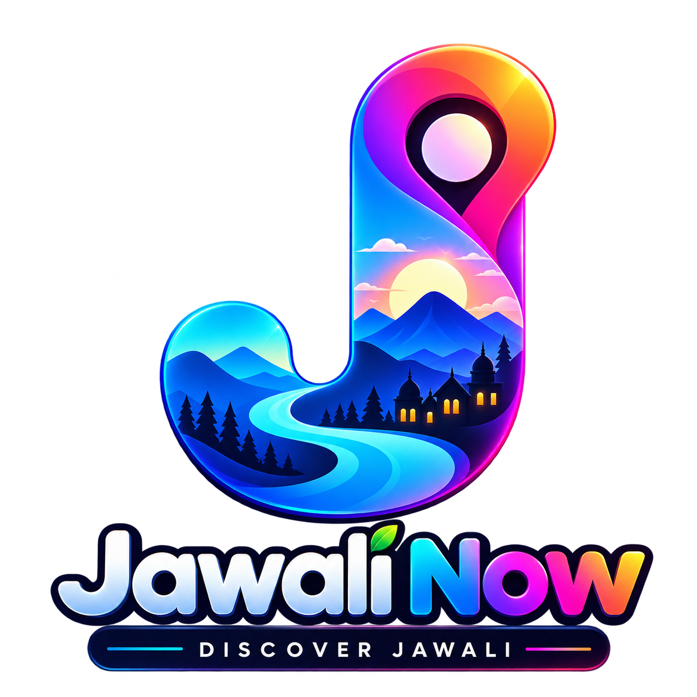
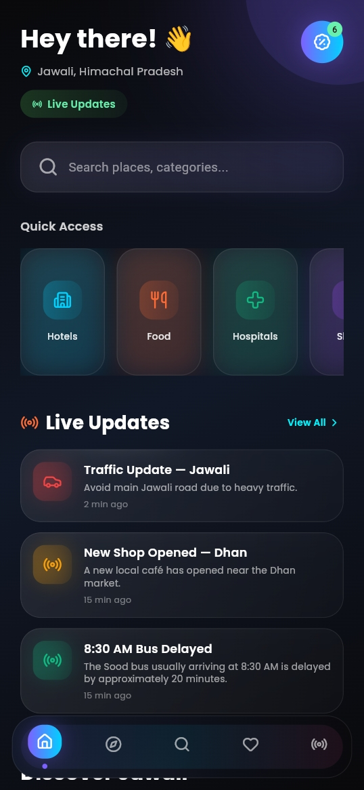

<div align="center">




# 📍 Jawali Now

### Discover Jawali — Everything Around You, In One Place.

<p>
A modern Flutter-based local discovery application built for Jawali, Himachal Pradesh.
</p>


</div>

---

# 🌐 About the Project :-

### Jawali Now is a modern local discovery application designed specifically for Jawali, Himachal Pradesh.

The application brings local businesses, services, places, offers, tourism spots, events and important local updates together in one platform.

Instead of searching for different local services separately, users can explore everything through a single simple and modern interface.

Jawali Now focuses on creating a futuristic, responsive and easy-to-use experience for discovering Jawali.

---

# Jawali Now Application Screenshots📱:-

##  Homepage :-


## Explore page:-


  ## Search Page:-


##  My Fav:-


##   Live Updates Page:-


##   Offers Page:-


##


---

# 🎯 Why Jawali Now? :-

Local businesses and services in smaller towns are often difficult to discover online.

Jawali Now aims to create a digital local ecosystem where people can easily discover:

- 🏨 Hotels
- 🍴 Restaurants & Food
- 🏥 Hospitals
- 🛍️ Shops
- 📍 Tourist Places
- 🎉 Events
- 🎁 Local Offers
- 📰 Local Updates

The long-term goal is to make Jawali more digitally connected and easier to explore.

---

# ✨ Features :-

- 🏠 **Modern Home Dashboard**
- 🔎 **Local Search**
- 🏨 **Business Categories**
- 📍 **Business Details**
- ❤️ **Favorites**
- 🎁 **Local Offers**
- 📰 **Live Updates**
- 📊 **Business Information**
- ⭐ **Ratings**
- 📏 **Distance Information**
- 📞 **Business Contact Information**
- 🟢 **Open / Closed Status**
- 🔥 **Trending Businesses**
- 📱 **Responsive UI**
- 🌙 **Dark Futuristic Interface**
- ✨ **Glassmorphism UI**
- 🌈 **Neon & Gradient Effects**
- ⚡ **Smooth Lightweight Animations**
- 🚀 **Modern Splash Screen**

---

# 🏠 Home Screen :-

The Home screen acts as the main discovery dashboard.

It includes:

- 👋 Personalized greeting
- 📍 Jawali location
- 🔎 Search bar
- ⚡ Quick Access categories
- 📰 Live Updates
- 🏨 Hotels
- 🍴 Food
- 🏥 Hospitals
- 🛍️ Shops
- 📍 Tourism
- 🎉 Events

---

# 🔎 Search :-

The Search section allows users to discover local places and categories.

Users can search for businesses and quickly find available information such as:

- Business name
- Category
- Rating
- Distance
- Location
- Business image

---

# 🏨 Categories :-

Jawali Now currently provides multiple local discovery categories.

| Category | Purpose |
|---|---|
| 🏨 Hotels | Discover hotels and stays |
| 🍴 Food | Restaurants and food places |
| 🏥 Hospitals | Healthcare and hospitals |
| 🛍️ Shops | Local shopping places |
| 📍 Tourism | Tourist destinations and places |
| 🎉 Events | Local events and activities |

---

# ❤️ Favorites :-

Users can save businesses they like and access them later from the Favorites section.

Favorites are designed to make frequently visited or preferred local businesses easier to access.

---

# 🎁 Offers :-

The Offers section showcases local discounts and promotional offers.

Each offer can contain:

- 🎟️ Offer Title
- 💰 Discount
- 📝 Description
- 🏪 Business Name
- 📂 Category
- 📅 Validity
- 🖼️ Offer Image

This can later be connected with real businesses and real-time offers.

---

# 📰 Live Updates :-

Jawali Now includes a Live Updates section for important local information.

Possible updates include:

- 🚗 Traffic Updates
- 📢 Local Announcements
- 🎉 Events
- ⚠️ Important Notices
- 🏘️ Community Updates

---

# 🎨 UI & Design :-

Jawali Now follows a modern futuristic design system.

The interface includes:

- 🌙 Dark Theme
- 🧊 Glassmorphism
- 🌈 Gradient Effects
- 💡 Neon Accents
- ✨ Soft Glow Effects
- 🔵 Rounded Cards
- 📱 Responsive Layouts
- ⚡ Lightweight Animations
- 🎯 Clear Visual Hierarchy
- 👆 Touch-Friendly Components

The goal is to make a local discovery application feel modern rather than like a traditional directory.

---

# 🛠️ Tech Stack :-

| Technology | Usage |
|---|---|
| Flutter | Application Framework |
| Dart | Programming Language |
| Google Fonts | Typography |
| Flutter SVG | SVG Support |
| Cached Network Image | Network Images |
| Flutter Animate | Animations |
| Lottie | Animation Support |
| Flutter Riverpod | State Management |
| GoRouter | Navigation |
| Glassmorphism | UI Effects |
| Blur | Blur Effects |
| Lucide Icons | Icons |
| Gap | Layout Spacing |

---
# 🚀 Getting Started :-

## 0️⃣ Get the Project Code

Clone the repository:

```bash
git clone https://github.com/reejalchoudhary/Jawali-Now.git
```

Move into the project directory:

```bash
cd Jawali-Now
```

### OR Download the ZIP

Go to:

**Code → Download ZIP**

Then:

1. Extract the downloaded ZIP.
2. Open the project folder in your code editor.
3. Install the dependencies.

---

## 1️⃣ Install Dependencies

```bash
flutter pub get
```

---

## 2️⃣ Check Flutter Setup

```bash
flutter doctor
```

---
## 3️⃣ Run the Application
```bash
flutter run
```
---

# 🔮 Future Scope :-

Jawali Now is designed to grow into a complete local digital platform.

Possible future features include:

- 🌐 Real Business Database
- 📍 Google Maps Integration
- 🗺️ Location-Based Discovery
- 👤 User Accounts
- 🏪 Business Owner Accounts
- 📝 User Submitted Businesses
- ⭐ Reviews & Ratings
- 🔔 Push Notifications
- 📰 Real-Time Local Updates
- 🎁 Real-Time Offers
- 🔎 Advanced Search
- 🎯 Advanced Filters
- 🛠️ Admin Dashboard
- ☁️ Cloud Backend
- 📊 Business Analytics
- 💬 User Feedback
- 📱 Business Promotion System

---

# 🧩 Data :-

The current version of Jawali Now uses local mock data for development and UI testing.

Business information is represented through the `BusinessModel`.

A business can contain:

- Name
- Category
- Description
- Rating
- Distance
- Address
- Phone
- Open Status
- Trending Status
- Image

---

# 📲 Follow Me :-

<p align="left">

<a href="https://dev.to/reejalchoudhary" target="_blank">

</a>

<a href="https://twitter.com/choudharyreejal" target="_blank">

</a>

<a href="http://www.linkedin.com/in/reejal-choudhary-532386237" target="_blank">

</a>

<a href="https://stackoverflow.com/users/reejalchoudhary" target="_blank">

</a>

<a href="https://instagram.com/reejalhere" target="_blank">

</a>

<a href="https://www.behance.net/reejalchoudhary" target="_blank">

</a>

</p>

---

# 📡 Contact Me :-

- Email📧: reejalree@gmail.com
- Mobile📞: 7018361108
---

<div align="center">


📍 JAWALI NOW

Discover Jawali.

A modern digital experience for Jawali, Himachal Pradesh.

</div>